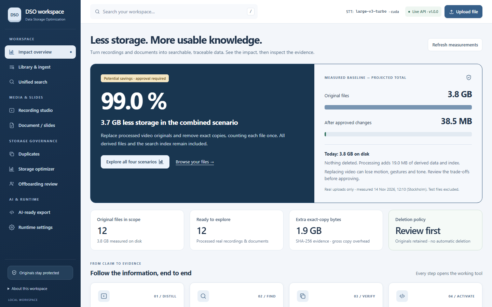
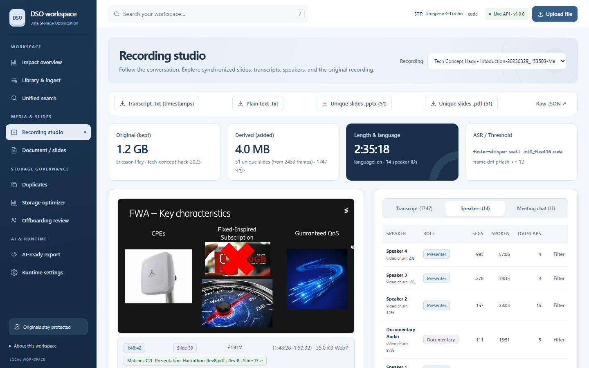
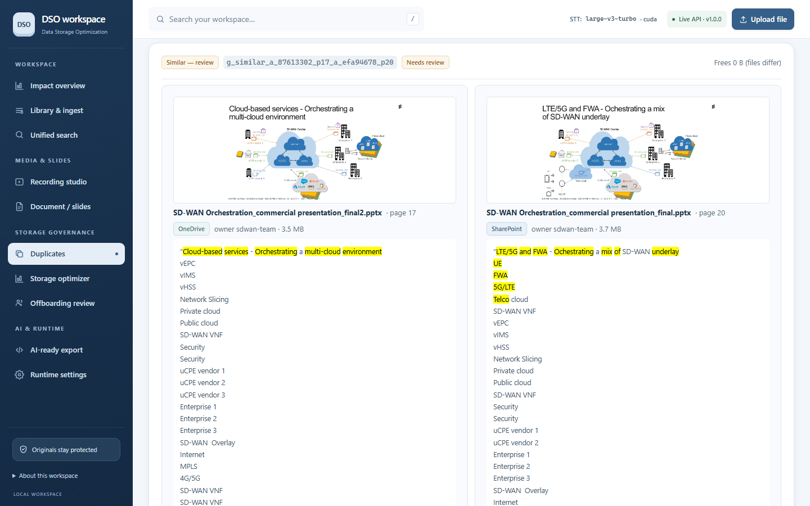
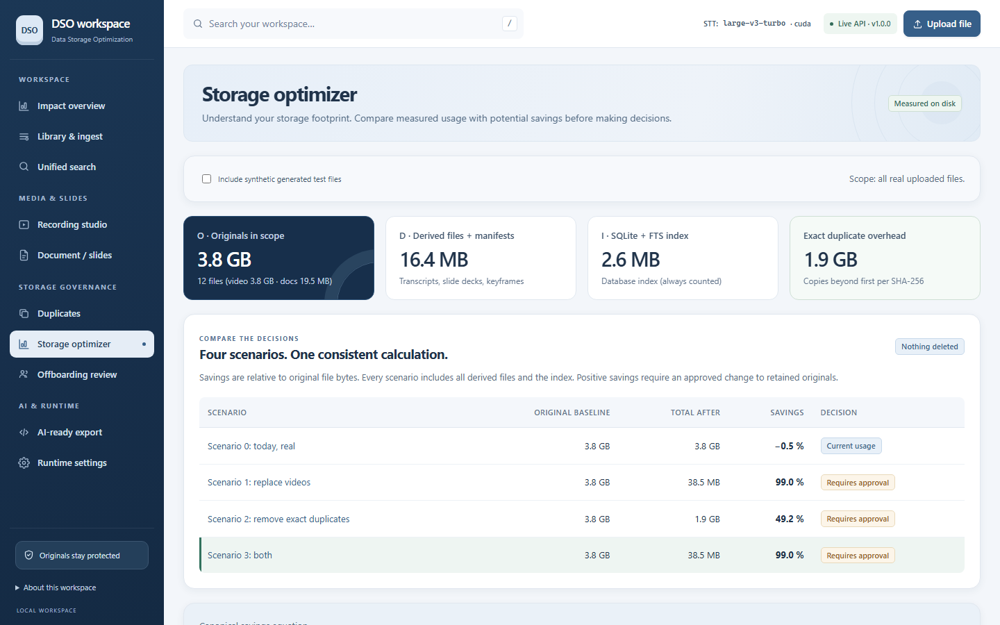
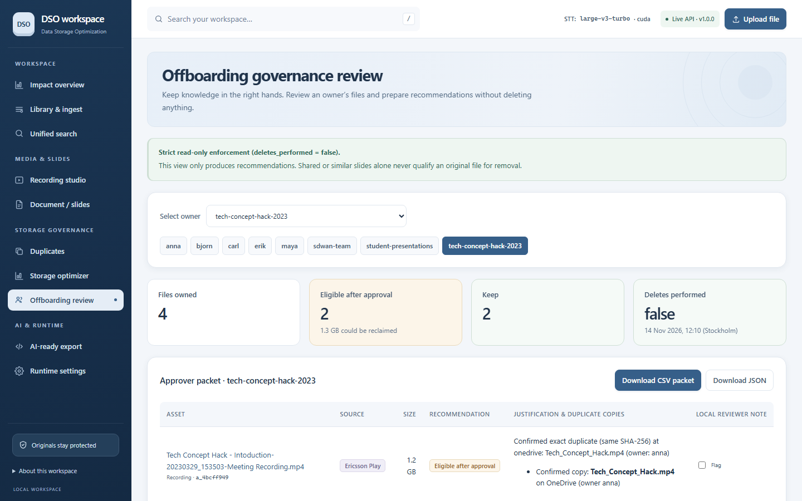
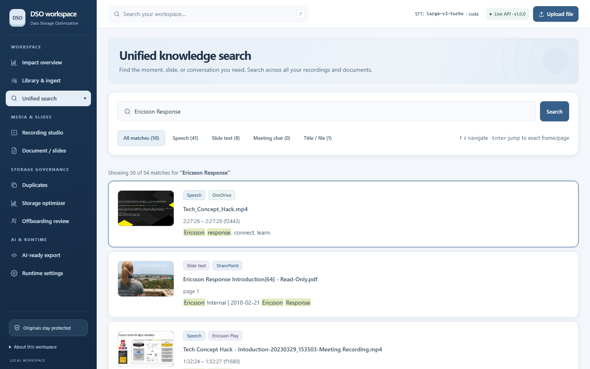
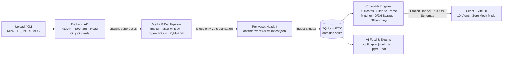

# Ericsson Data Storage Optimization — Campor × BUILD Hackathon 2026

[](https://github.com/suhasubasi/ericsson-data-storage-optimization/actions/workflows/ci.yml)

**Turn multi-hour recordings and sprawling slide decks into compact, searchable, AI-ready knowledge across simulated SharePoint, OneDrive, and Ericsson Play — without ever deleting an original file.**

> **One-command Docker start:** `docker compose up --build` → open `http://localhost:5173` *(bundles `ffmpeg`, LibreOffice Impress for `.pptx` slides, isolated backend + ML pipeline venvs, and persistent `./data` + model cache volumes; NVIDIA GPU: `docker compose -f compose.yaml -f compose.gpu.yaml up --build`)*  
> **Manual Windows setup:** [`START-HERE.md`](START-HERE.md) · Data contracts & formulas: [`contracts/CONTRACTS.md`](contracts/CONTRACTS.md)

---

## Executive Summary & Measured Impact

Ericsson teams store gigabytes of internal recordings, downloaded presentations, and overlapping slide revisions across SharePoint, OneDrive, and Ericsson Play. When quotas fill up, forcing manual deletions destroys institutional knowledge and future AI training data.

This prototype addresses both halves of the brief (**Storage Reduction** + **Data Activation**) on real local hackathon recordings and presentations while enforcing strict non-destructive governance (`deletes_performed = false`, no `DELETE` API route, read-only originals):

| Metric / Scenario | Measured Result (`12` Curated Real Assets) | Accounting Basis (`CONTRACTS.md §6`) |
|---|---:|---|
| **Originals in scope (`O`)** | **3.78 GB** (`3,779,698,342 B`) | `8` MP4 recordings (`4` unique talks + `4` cross-owner copies) & `4` PDF/PPTX decks |
| **Derived knowledge payload (`D`)** | **16.44 MB** (`16,443,808 B`) | Transcripts, unique WebP slides, PDF/PPTX page renders, manifests |
| **Search & metadata index (`I`)** | **2.60 MB** (`2,600,960 B`) | Checkpointed SQLite + FTS5 database (`data/dso.sqlite`) |
| **Scenario 0 · Today (real on disk)** | **`-0.5%`** (`3.80 GB` total) | Honest accounting: processing adds `19.04 MB` (`D + I`) until human cleanup approval |
| **Scenario 1 · Replace processed videos** | **`99.0%` saved** (`38.51 MB` kept) | Replaces `3.76 GB` video originals with derived knowledge; retains docs, `D`, and `I` |
| **Scenario 2 · Remove exact copies** | **`49.2%` saved** (`1.92 GB` kept) | Flags `1.88 GB` (`1.86 GB` net of `D + I`) in byte-identical cross-owner SHA-256 copies |
| **Scenario 3 · Combined (no double-count)** | **`99.0%` saved** (`38.51 MB` kept) | Dedupes exact copies and replaces processed videos; counts every file once |
| **Visual frame compaction (`slides-only v3`)** | **`98.0%` smaller** (`163.59 MB → 3.22 MB`) | `3,501` candidate video frames distilled to `84` unique slides across the 4 talks |
| **AI-ready streaming corpus** | **`4,747` chunks** (`4.77 MB` JSONL) | Provenance-linked transcript segments + slide texts via `GET /api/export.jsonl` |



---

## Problem Scope: Causes vs. Symptoms

| Surface Symptom | Underlying Root Cause Addressed |
|---|---|
| *SharePoint/OneDrive quotas exceeded* | Multi-hour screen-share MP4s repeat nearly identical frames (98%+ frame redundancy) while speech remains locked inside unindexed audio streams. |
| *Duplicate cleanups risk breaking links* | Users re-upload recordings/decks under different filenames (`Tech_Concept_Hack.mp4`, `(1).pdf`), defeating filename matching — solved via **SHA-256 byte identity**. |
| *Modified deck versions confuse storage audits* | Revised decks (`final.pptx` vs. `final2.pptx`) share identical templates yet alter technical architecture (`5G/LTE` vs. `multi-cloud`), requiring **perceptual + word-level diff review** rather than auto-deletion. |
| *Employee offboarding deletes unique knowledge* | Admins lack an automated cross-system ownership check showing which files have verified exact copies elsewhere vs. unique assets that must be kept. |

---

## Live Application Walkthrough

### 1. Recording Studio: Synced Slides, Diarized Speakers & Source-of-Truth Linking

Long recordings become structured, skimmable briefings. On the **2h 35m (`1.22 GB`)** *Tech Concept Hack* recording alone, local extraction distills **`2,453` candidate frames (`124.17 MB`) into `51` unique slides (`2.29 MB`)** across `74` timeline ranges, aligns **`1,747` speech segments** across **`14` locally diarized speakers** (`Presenter` / `Documentary` / `Unknown` roles), maps **`11` time-aligned Teams `.msg` chat messages**, and automatically links **`37` of `74` frame ranges** back to canonical source PDF pages (`C2L_Presentation_Hackathon_RevB.pdf`, `Ericsson Response Introduction.pdf`).



### 2. Cross-System Duplicate & Revision Diff Analyzer

Never conflates "identical" with "similar":
- **Exact file copy (`4` groups, SHA-256):** Byte-identical recordings across `Ericsson Play`, `OneDrive`, and `SharePoint` (e.g., `Tech_Concept_Hack.mp4` vs. original recording) marked with extra reclaimable bytes.
- **Shared slide (`18` groups, normalised-text SHA-256 + pHash ≤ 6):** Identical slides reused across different decks — frees `0 B` because surrounding files differ.
- **Similar — review (`11` groups, `text_ratio` / pHash):** Flags subtle edits between `SD-WAN Orchestration_commercial presentation_final.pptx` and `final2.pptx` with yellow word-level diffs (`Frees 0 B · Needs review`).



### 3. Audit-Grade Four-Scenario Storage Optimizer

Compares **Scenario 0** (honest `-0.5%` today because `D + I` are added before cleanup approval) side by side with **Scenarios 1–3** (`49.2%` duplicate-only vs. `99.0%` video-replacement/combined). Explicitly lists **Excluded items** (*backups, platform replication, compute, model weights, cost*) and **Information lost if video originals are deleted** (*motion/live demos, gestures, tone unless optional audio is retained, real-world speaker names*).



### 4. Governance-Safe Offboarding Review

Auditing owner `tech-concept-hack-2023` identifies `4` owned files: `2` videos (`1.31 GB`) verified by SHA-256 against copies held by `anna` and `maya` on `OneDrive` (`Eligible after approval`) and `2` unique PDFs (`Keep`). Enforces `deletes_performed = false` across both UI and API, exporting signed-off CSV/JSON approver packets.



### 5. Unified Knowledge Search & AI-Ready Provenance Export

SQLite **FTS5 (`unicode61 remove_diacritics 2`)** indexes speech transcripts, extracted PDF/PPTX slides, file metadata, and attached Outlook `.msg` chat logs in one query bar (`"Ericsson Response"` → `54` matches across Speech, Slide text, and File titles in milliseconds), jumping straight to the exact video timestamp or slide page. Alongside search, `GET /api/export.jsonl` streams `4,747` provenance-tagged JSONL chunks (`4.77 MB`) with source file hashes, slide links, speaker roles, and `confidence: null` wherever no calibrated score exists.



---

## Ericsson Challenge Brief Traceability

| Brief Requirement (`Challenge_Ericsson.docx`) | Delivered in Prototype | Status / Boundary |
|---|---|---|
| Compressing ~1 GB / 2h recordings (~99% target) into text + key frames | `1.22 GB` (`2h 35m`) recording → **`4.05 MB`** derived payload (**`99.7%`** per-asset; **`99.0%`** library-wide incl. docs & index) | Measured |
| Speech transcription with speaker differentiation | Local `faster-whisper` (`small` / `large-v3-turbo` / `large-v3`) + Silero VAD & SpeechBrain ECAPA-TDNN `Speaker 1..N` + role heuristics | Anonymous IDs only (no voice-to-employee PII matching) |
| Slide capture linked to source-of-truth document/slide ID | Perceptual hash (`pHash`) + transcript token Jaccard matching links video ranges (`f1917`) to canonical deck pages (`Rev B · Slide 17`) | Verified on `37/74` ranges in *Tech Concept Hack* |
| Detect duplicates & minor deck revisions across platforms | File SHA-256 (`exact_file`), normalised text hash + pHash (`shared_slide`), word-diff + pHash (`similar_slide`) | Simulated `sharepoint` / `onedrive` / `ericsson_play` tags |
| Search across recordings, slides & chat + AI-ready output | SQLite FTS5 unified search (`speech`, `slide`, `chat`, `asset`) + streaming `GET /api/export.jsonl` (`4,747` chunks) | Local FTS5 + JSONL; vector DB deferred to Phase 3 |
| Employee offboarding duplicate verification | Per-owner inventory audit checking cross-owner SHA-256 exact matches (`eligible_after_approval` vs. `keep`) + CSV/JSON approver packet | **Never deletes** (`deletes_performed = false`) |
| Prompt-based slide recreation / full video reconstruction | Unique slides exportable as clean `.pptx` / `.pdf` packs for lightweight viewing | Full generative video/slide recreation marked out-of-scope |

---

## System Architecture & Engineering Separation

Three decoupled engineering streams communicate **strictly through frozen schemas in [`contracts/`](contracts/CONTRACTS.md)** and a per-asset `manifest.json` handoff — no stream imports another stream's Python or TypeScript internals.



```text
contracts/   SHARED, FROZEN — openapi.yaml, schema.sql, JSON Schemas, thresholds.json, generated TS/Pydantic types
backend/     FastAPI + SQLite FTS5 + cross-file duplicate matcher + storage/offboarding/chat/export engines
pipeline/    ffmpeg + OpenCV + faster-whisper + Silero VAD + SpeechBrain + PyMuPDF + imagehash (writes manifest.json)
frontend/    React + Vite + TypeScript (always live API, zero mock mode)
docs/        Verified UI screenshots (docs/screenshots/) & architecture specs
data/        originals/ (read-only CHMOD protected, gitignored) · derived/<asset_id>/ · dso.sqlite
```

### What We Reused vs. What We Built

| Layer | Reused Libraries & Models | Custom-Built Logic in This Repository |
|---|---|---|
| **Contract & Safety** | `FastAPI`, `Pydantic`, `JSON Schema`, SQLite `FTS5` | Frozen multi-stream contract codegen (`contracts/scripts/generate.sh`), atomic read-only original storage, strict zero-delete governance invariants |
| **Video & Visual Distillation** | `ffmpeg`, `OpenCV`, `ImageHash` (`pHash`), `Pillow` | **`slides-only v3` deduplication engine** (`pipeline/dso_pipeline/unique_slides.py`): persistent border/chat-rail masking, live camera churn suppression, backwards-run absorption so animated slide builds collapse to their completed slide (`3,501 → 84` slides) |
| **Speech & Diarization** | `faster-whisper` (CTranslate2), `Silero VAD`, `SpeechBrain` ECAPA-TDNN, `scikit-learn` | Two-pass local speaker clustering (`pipeline/dso_pipeline/diarize.py`), overlap flagging, and `Presenter` vs. `Documentary` visual-churn heuristic classifier |
| **Cross-Media Matching** | `PyMuPDF`, `python-pptx`, `difflib`, `extract-msg` | Deck-anchored slide-to-frame pHash + transcript Jaccard matcher (`backend/app/duplicates.py`), self-export exclusion, Outlook `.msg` clock-to-video offset estimator (`backend/app/chat.py`), and word-level revision highlighter |

---

## Measured Benchmarks (STT & Quality)

### Speech-to-Text Throughput (`RTX 5070 Laptop GPU 8 GB`, `AMD Ryzen AI 7 350`, 13 Nov 2026)

Same decode settings across all runs (beam `5`, VAD silence filter enabled; excluding one-off model load: `1.5 s` `small`, `~3.3 s` `large-v3-turbo`, `5–6.5 s` `large-v3`):

| Recording | `small` CPU | `small` GPU | `large-v3-turbo` GPU | `large-v3` GPU |
|---|---:|---:|---:|---:|
| **Jury and prizes** (`6 min`) | `25.7 s` | `7.8 s` | **`5.0 s`** | `14.0 s` |
| **GraalVM talk** (`16 min`) | `83.5 s` | `24.7 s` | **`20.1 s`** | `49.3 s` |

- CPU baseline (first `60 s` of *Jury and prizes*): `small` `7.0 s`, `large-v3-turbo` `22.8 s`, `large-v3` `34.1 s` (roughly `~23 min` estimated on CPU per 1h audio using `large-v3-turbo`).
- **Observed transcription accuracy caveats (no human ground-truth WER computed):** `94–95%` token agreement between `small` and large models; `96–98%` between `large-v3-turbo` and `large-v3`. Domain/proper names still show phonetic errors on smaller models (e.g., `"ahead of time completion"` → `"ahead of time compilation"` on `large-v3-turbo`; `"Whitecamp"` vs. `"Weitekamp"` or `"Tommy Watson"` resolved cleanly only on `large-v3`). On UI **Settings**, select `large-v3-turbo` + `GPU` when CUDA is available, or keep `small` + `CPU`.

---

## Automated Verification & CI Status

| Suite | Command | Latest Observed Result |
|---|---|---|
| **Backend (`pytest`)** | `cd backend && .\.venv\Scripts\python.exe -m pytest -ra` | **`81 passed`** (API contracts, DB/FTS5, duplicates, storage math, offboarding, exports, chat) |
| **Pipeline (`pytest`)** | `cd pipeline && .\.venv\Scripts\python.exe -m pytest -ra` | **`74 passed, 1 skipped`** (`tests/test_presentation.py::test_pptx_to_pdf_via_libreoffice` skipped cleanly because LibreOffice is not installed locally) |
| **Frontend (`tsc` + unit + `vite build`)** | `cd frontend && npm run typecheck && npm test && npm run build` | **Typecheck OK · `6/6` JS formula tests passed · `vite build` clean** |
| **Contracts CI** | Defined in [`.github/workflows/ci.yml`](.github/workflows/ci.yml) (`contracts` job) | Runs Schema/OpenAPI/TS/Pydantic codegen validation using `.venv-tools` (`openapi_spec_validator` not installed in app runtime `.venv`) |

---

## Honest Limitations & Enterprise Rollout Roadmap

### Known Technical Limitations

1. **Simulated Cloud Connectors:** `sharepoint`, `onedrive`, and `ericsson_play` are ingestion metadata labels (`source_simulated = true`); no Microsoft Graph / Ericsson Play API credentials are bundled.
2. **Offline Speaker Identity:** Local diarization groups voices into anonymous `Speaker 1..N` labels and role cues — it does not map voices to employee directories without explicit consent/enrollment.
3. **Domain Terminology in ASR:** Phone/telecom acronyms (`CPE`, proper names) can mis-transcribe under Whisper `small`, which is why cross-linking speech segments to source PDF slide text matters.
4. **Optional LibreOffice Dependency:** Converting `.pptx` decks into rendered page PDFs requires `soffice` on `PATH`; without it, visual slide deck export gracefully builds JPEG-packed `.pptx`/`.pdf` bundles directly from extracted WebP slides.

### Phased Enterprise Rollout Plan

1. **Phase 1 — Read-Only Shadow Indexing (Low Risk):** Deploy headless pipeline workers inside Ericsson VPC connected to read-only SharePoint/OneDrive/Ericsson Play webhooks. Surface duplicate & offboarding metrics to site owners with zero mutations.
2. **Phase 2 — Approval-Gated Storage Reclamation:** Connect `Offboarding Review` approver packets (CSV/JSON) to IT retention queues so human admins execute confirmed SHA-256 deduplication or archival tiering.
3. **Phase 3 — Enterprise AI Activation:** Stream `GET /api/export.jsonl` chunks (complete with provenance hashes and canonical slide links) into Ericsson's internal RAG vector stores while preserving document revision lineage.

---

## Safety Rules & Whisper Setup

- **Read-only originals:** Originals are stored with OS read-only flags; no API endpoint deletes or modifies original files (`deletes_performed = false`).
- **Local-first privacy:** Audio/video/slides never leave the machine; sample data under `Brief/` and `data/` remain gitignored.
- **Model downloads (optional):** `small` auto-downloads on first run (~0.5 GB). Pre-fetch larger GPU models once via `pipeline\.venv\Scripts\python.exe -c "from faster_whisper.utils import download_model; print(download_model('large-v3-turbo'))"` (see [`pipeline/README.md`](pipeline/README.md#nvidia-gpu-opt-in) for CUDA setup; env vars `DSO_WHISPER_MODEL` / `DSO_WHISPER_DEVICE` override UI Settings).

<details>
<summary><strong>Resolved Contract Ambiguities (see contracts/CONTRACTS.md)</strong></summary>

1. Brief mentions "3 scenarios" in summary table vs. **4** (0–3) in formulas → ship **4** scenarios (`0` baseline through `3` combined).
2. General savings formula counts `A = kept originals + all derived + index` across every scenario (conservative accounting vs. shorthand approximations).
3. Local slide/frame IDs (`p4`, `f3`) are scoped per asset via `(asset_id, id)` and referenced globally as `<asset_id>:<id>`.
4. Pipeline runs per-file; cross-file hashing comparison runs in backend SQLite over ingested manifests.
5. Offboarding eligibility checks confirmed cross-owner **SHA-256 exact matches** only (`shared_slide` / `similar_slide` do not qualify).
6. Backend measures `manifest.json` bytes directly upon ingest and includes them in derived total `D`.

</details>
